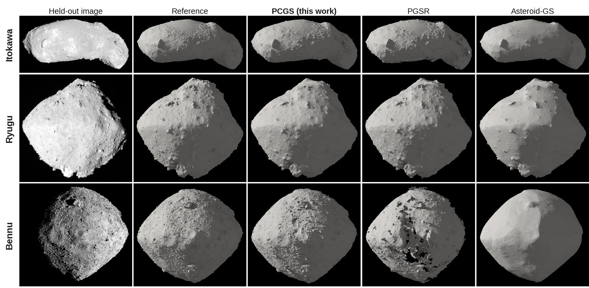

<div align="center">

# PCGS: Photometrically Constrained Gaussian Splatting for Sparse-View Asteroid Shape Reconstruction

**Xin-Yu Xiao<sup>1,2</sup> &nbsp; Fei He<sup>1,2</sup>**

<sup>1</sup>Institute of Geology and Geophysics, Chinese Academy of Sciences &nbsp;
<sup>2</sup>University of Chinese Academy of Sciences

Submitted to *Astronomy & Astrophysics*

[Project page](https://xin-yuxiao.github.io/AsteroidModeling/) &nbsp;|&nbsp; Paper (coming soon) &nbsp;|&nbsp; arXiv (coming soon) &nbsp;|&nbsp; Data and meshes (Zenodo, upon publication)


</div>



PCGS reconstructs closed global shape models of asteroids from a few dozen spacecraft images. It extends
[2D Gaussian Splatting](https://github.com/hbb1/2d-gaussian-splatting) (2DGS) so that the known solar
illumination constrains the geometry: each surfel carries a view-independent albedo that is shaded by a
lunar-Lambert function under the SPICE Sun direction of each image, so that image brightness constrains the
surface orientation, as in photoclinometry.

## Highlights

- **Photometric rendering under the known Sun.** The rendered albedo is shaded by the lunar-Lambert function
  of the rendered surfel normal, the Sun vector of the image and the view ray, and from 15&deg; phase angle
  multiplied by cast shadows from a Sun-view shadow map: &Icirc; = A &middot; &Phi;(&mu;<sub>0</sub>, &mu;; L) &middot; V.
- **Low phase angle and the night side.** An albedo total-variation prior below 15&deg; separates albedo from
  shading; a band beyond the terminator is excluded from the silhouette loss, so that the unlit body is not
  carved away at high phase angle.
- **Reference-free extraction.** Depth on which several views agree is fused by screened Poisson
  reconstruction, unobserved regions are faired, and the mesh is offset to the SfM tie points. No step uses a
  reference model.
- **Accuracy.** Mean distances of 0.59 m (Itokawa) and 0.62 m (Ryugu) to the mission shape models, 37% and
  15% lower than the best competing method, and 0.62 m to the laser-altimeter model of Bennu, which is
  independent of the images. At the registered scale the volumes agree with the references to within 0.3%.
- **Cost.** About half an hour of training per run on one A100 (17&ndash;47 min measured on a shared node),
  plus 4&ndash;10 min of mesh extraction.

## Contents

- [Repository layout](#repository-layout)
- [Installation](#installation)
- [Data preparation](#data-preparation)
- [Quick start](#quick-start)
- [Training](#training)
- [Mesh extraction](#mesh-extraction)
- [Evaluation](#evaluation)
- [Reproducing the paper](#reproducing-the-paper)
- [Benchmark and paper](#benchmark-and-paper)
- [Results](#results)
- [Tests](#tests)
- [Troubleshooting](#troubleshooting)
- [Citation](#citation), [Acknowledgements](#acknowledgements), [License](#license)

## Repository layout

```
AsteroidModeling/
  train.py, render.py      2DGS training with the PCGS options; 2DGS renderer
  arguments/ gaussian_renderer/ scene/ utils/ submodules/     2DGS code (NOTICE.md lists the changes)
  pcgs/                    extras.py: photometry, cast shadows, priors, silhouette, NCC, pixel convention,
                           depth fusion; render_views.py: held-out views; decompose.py: albedo/shading maps
  extraction/              mvfuse.py (multi-view-consistent fusion + Poisson), fair_holes.py, offset_to_sfm.py
  evaluation/              align_to_sfm.py, smooth_mesh.py, eval_mesh.py (shape), nvs_metrics.py (images)
  data/                    download of the mission data and construction of the scenes; lists/ holds the
                           frames and splits of the paper (no data files)
  configs/                 one file per image set with the training options of the paper
  scripts/                 prepare_data.sh, run_campaign.sh, reproduce_paper.sh, summarize.py
  tests/                   CPU unit tests (python -m pytest)
  benchmark/               comparison with the baselines, job queue, tables and figures of the paper
  paper/                   LaTeX source of the manuscript (A&A)
  docs/                    project page (https://xin-yuxiao.github.io/AsteroidModeling/)
```

## Installation

Tested on Linux with an NVIDIA A100, CUDA 11.8, Python 3.10 and PyTorch 2.1.2.

```bash
git clone --recursive https://github.com/Xin-YuXiao/AsteroidModeling.git && cd AsteroidModeling   # or: git submodule update --init --recursive
conda env create -f environment.yml && conda activate pcgs
export CUDA_HOME=/usr/local/cuda-11.8                        # the toolkit that matches pytorch-cuda 11.8
pip install --no-build-isolation submodules/diff-surfel-rasterization submodules/simple-knn
```

Data preparation uses its own environment (COLMAP via pycolmap, SPICE, astropy; CPU only):

```bash
conda create -n pcgs-data python=3.11 && conda activate pcgs-data
pip install -r data/requirements.txt
```

## Data preparation

Five public image sets of three asteroids. Data go to `$PCGS_DATA` (default `./datasets`, not tracked by git).

| Image set | Camera | Dates | Images | Phase angle | Reference shape model |
|---|---|---|---|---|---|
| `itokawa` | Hayabusa AMICA | 2005 Sep 29 &ndash; Oct 2 | 60 | 9.3&ndash;10.4&deg; | SPC, Gaskell et al. (3.1 M facets) |
| `ryugu_7deg` | Hayabusa2 ONC-T | 2019 Jan 15 | 60 | 7.1&ndash;7.3&deg; | SfM-MVS, Watanabe et al. 2019 (3 M facets) |
| `ryugu_19deg` | Hayabusa2 ONC-T | 2018 Jul 10 | 60 | 18.5&ndash;18.7&deg; | SfM-MVS, Watanabe et al. 2019 |
| `ryugu_40deg` | Hayabusa2 ONC-T | 2018 Aug 31 | 48 | 39.9&ndash;40.3&deg; | SfM-MVS, Watanabe et al. 2019 |
| `bennu` | OSIRIS-REx MapCam | 2018 Nov 30 &ndash; Dec 13 | 60 | 26.1&ndash;59.9&deg; | OLA laser-altimeter global model v21 |

Each image set is split three times at random (seeds 0&ndash;2) into 50 training and 10 held-out images
(40 and 8 for `ryugu_40deg`).

**Bennu reference (manual step).** Place the OLA global shape model v21,
`g_00880mm_alt_obj_0000n00000_v021.obj` (0.88 m facets, km, IAU_BENNU), from the OSIRIS-REx shape-model
archive of the PDS Small Bodies Node in `datasets/bennu/shape/` before running `prepare_data.sh bennu`;
the archive does not allow scripted downloads, and the script stops with a message if the file is missing.

```bash
conda activate pcgs-data
bash scripts/prepare_data.sh itokawa        # likewise ryugu_19deg, ryugu_7deg, ryugu_40deg, bennu
```

For each image set the script downloads the images and SPICE kernels (`data/fetch_*.sh`: JAXA DARTS, NAIF,
and the PDS Small Bodies Image Browser for Bennu), computes the per-image geometry from SPICE (camera pose,
Sun direction, phase angle), selects the frames, writes 8-bit PNG images and lit masks, matches SIFT
features in COLMAP, refines the SPICE poses by triangulation and bundle adjustment, aligns the result to the
SPICE camera centres (body-fixed frame, km), writes the three splits, and computes the evaluation-only
transform from the camera frame to the reference model (trimmed ICP of the SfM tie points). It then compares
the selected frames and splits with those of the paper (`data/lists/<image set>/`) and prints `SCENE_OK`.
The downloads amount to about 1.6 GB for Ryugu (images and reference model) and less for the other bodies;
the five prepared scenes take about 5 GB.

Resulting layout (the scene format is that of 3DGS/2DGS, a COLMAP text model, plus `meta.json` with the
per-image Sun vectors and phase angles):

```
datasets/<image set>/
  spice/ shape/ fits|raw|frames/       downloaded inputs
  ref_mesh_km.ply                      reference shape model (evaluation only)
  scene/                               images/ masks/ sparse/0/ meta.json splits/ frame_to_ref.json
  scene_split{0,1,2}/                  images, masks, sparse -> scene/; test_images.txt
```

COLMAP runs multi-threaded, so a rebuilt scene can differ from ours at the level of the SfM noise even when
the frames and splits are identical.

## Quick start

One run on one split, end to end (training, held-out renders, mesh extraction, evaluation):

```bash
conda activate pcgs
bash scripts/run_campaign.sh itokawa 0 0       # <image set> <split> [gpu]
python scripts/summarize.py itokawa
```

Outputs go to `output/itokawa/pcgs_s0/` (`$PCGS_OUTPUT`): the trained surfels
(`point_cloud/iteration_30000/`), the held-out renders (`test/ours_30000/`), the meshes, and the metrics
(`table_mesh_mvpoisson_fairoff_sfm_t20.json`, `nvs_table.json`). Steps whose outputs exist are skipped, so
an interrupted run can be restarted with the same command.

## Training

`scripts/run_campaign.sh` reads the options of the paper from `configs/<image set>.sh`; they are the same
for every image set. The training step alone is

```bash
S=datasets/itokawa/scene_split0
export OBJECT_EXTENT=$(python -c "import numpy as np; p=np.loadtxt('$S/sparse/0/points3D.txt', usecols=(1,2,3), comments='#'); print(round(1.1*np.percentile(np.linalg.norm(p,axis=1),99),5))")
python train.py -s $S -m output/itokawa/pcgs_s0 --eval \
  --depth_ratio 1 --lambda_mask 0.05 --sun_shading --sh_degree 0 --lambda_mv 0.15 --mv_mode ncc --pixfix \
  --limb_halfmax --lambda_albedo_tv 0.1 --tv_max_phase 15 --cast_shadows --shadow_slope 1.0 \
  --shadow_gate 0.9 --shadow_min_phase 15 --sil_night
```

`OBJECT_EXTENT` (km) replaces the camera-ring radius that 2DGS uses to scale densification and the position
learning rate: the spacecraft is many body radii away, so the camera ring is about 30 times too large a scale
for the target. `train.py` stops if PCGS options are given without it. All PCGS options are off by default,
so `train.py` without them trains plain 2DGS.

**Options used in the paper**

| Option | Meaning | Default | Paper |
|---|---|---|---|
| `--sun_shading` | albedo &times; lunar-Lambert shading under the SPICE Sun, from `--shading_from_iter` (3000) | off | on |
| `--sh_degree 0` | view-independent albedo (2DGS option) | 3 | 0 |
| `--depth_ratio 1` | median depth (2DGS option) | 0 | 1 |
| `--lambda_mask` | silhouette (binary cross-entropy) weight | 0 | 0.05 |
| `--limb_halfmax` | silhouette target at the half-maximum of the blurred limb | off | on |
| `--sil_night` | silhouette loss ignores the band beyond the terminator where the unlit body may lie | off | on |
| `--lambda_mv`, `--mv_mode` | multi-view patch consistency (NCC), from `--mv_from_iter` (7000) | 0, ncc | 0.15, ncc |
| `--lambda_albedo_tv`, `--tv_max_phase` | albedo total variation in images below this phase angle (deg) | 0, 180 | 0.1, 15 |
| `--cast_shadows` | Sun-view shadow map multiplies the shading | off | on |
| `--shadow_slope`, `--shadow_gate`, `--shadow_min_phase` | slope-scaled bias, darkness gate, minimum phase angle (deg) | 0, 0, 0 | 1.0, 0.9, 15 |
| `--shadow_res`, `--shadow_bias_m`, `--shadow_tau_m` | Sun-view resolution, constant bias and edge softness (m) | 1024, 3, 0.5 | defaults |
| `--pixfix` | COLMAP principal point and pixel-centre convention for rendering, depth lifting and fusion | off | on |

**Variants and ablations.** `run_campaign.sh` takes `DROP_FLAGS` (switches to remove), `EXTRA_FLAGS` (appended;
a later value overrides an earlier one) and `TAG` (output directory name), for example

```bash
DROP_FLAGS=--sil_night TAG=pcgs_noband bash scripts/run_campaign.sh bennu 0        # without the night-side band
EXTRA_FLAGS="--lambda_mv 0" TAG=pcgs_nomv bash scripts/run_campaign.sh itokawa 0  # without multi-view NCC
```

## Mesh extraction

```bash
M=output/itokawa/pcgs_s0; S=datasets/itokawa/scene_split0     # OBJECT_EXTENT as above
python pcgs/render_views.py -s $S -m $M --sun_shading                # held-out views, test/ours_30000/
python extraction/mvfuse.py -s $S -m $M                     # mesh_mvpoisson.ply (+ mesh_mvtsdf.ply)
python extraction/fair_holes.py $M                          # mesh_mvpoisson_fair.ply
python extraction/offset_to_sfm.py $S $M/mesh_mvpoisson_fair.ply $M/mesh_mvpoisson_fairoff.ply
```

`mvfuse.py` keeps the median depth of a training view where at least 3 of its 6 neighbouring views
(3&ndash;40&deg; apart) see the back-projected point at the same depth within 1.5 m, and meshes these
oriented points by screened Poisson reconstruction (octree depth 11). `fair_holes.py` re-solves the vertices
farther than 2 m from the TSDF of the same depths (plus two rings) as a bi-Laplacian membrane, and
`offset_to_sfm.py` removes the median offset of the surface from the SfM tie points along the vertex normals.

**`mesh_mvpoisson_fairoff.ply` is the PCGS shape model**, in the body-fixed frame of the cameras, in km. It is
closed: it has no boundary edges, and a few (at most five in the paper) of its ~10<sup>7</sup> edges can be
non-manifold. The numbers of the paper are measured on `mesh_mvpoisson_fairoff_sfm_t20.ply`, the same mesh after
the post-processing that the evaluation applies to every method (below).

`pcgs/decompose.py` writes the observed image, the prediction, the albedo, the shading, the normals and the
opacity of chosen views (Fig. 1 of the paper).

## Evaluation

The protocol of the paper, applied identically to every method:

```bash
SC=datasets/itokawa/scene; MESH=$M/mesh_mvpoisson_fairoff
python evaluation/align_to_sfm.py $SC $MESH.ply ${MESH}_sfm.ply           # translation + normal offset to SfM points
python evaluation/smooth_mesh.py ${MESH}_sfm.ply ${MESH}_sfm_t20.ply 20    # Taubin, 20 iterations
python evaluation/eval_mesh.py --rec ${MESH}_sfm_t20.ply --ref datasets/itokawa/ref_mesh_km.ply \
  --out $M/table_mesh_mvpoisson_fairoff_sfm_t20.json --keep-largest \
  --frame-tf $SC/frame_to_ref.json --align similarity frame --samples 1000000
python evaluation/nvs_metrics.py --run $M --device cuda                    # PSNR / SSIM / LPIPS, held-out images
```

Neither the alignment nor the extraction uses the reference model. The reconstruction is registered to the
reference by one similarity transform per image set, estimated from the SfM tie points alone and shared by every
method (`--align frame`); the tables of the paper report this block. Mean and RMSE are distances from the mesh
vertices to the reference surface; F@1 m is the harmonic mean of the shares of reconstructed and reference
samples (10<sup>6</sup> each) within 1 m of the other surface. The volume is reported for closed meshes.
Image metrics are computed on the held-out images after one least-squares gain and offset per image over the
lit mask, which `nvs_metrics.py` copies from the training scene. `EVAL_ALL=1 bash scripts/run_campaign.sh ...`
also evaluates the mesh before and after the alignment alone.

## Reproducing the paper

```bash
bash scripts/reproduce_paper.sh 0      # the paper's 12 runs, GPU 0, one run at a time
python scripts/summarize.py            # mean +- s.d. over the splits
```

The paper trained three splits of `itokawa`, `ryugu_19deg` and `bennu`, splits 0&ndash;1 of `ryugu_40deg` and
split 0 of `ryugu_7deg`; `ALL_SPLITS=1` runs all three splits everywhere. Each run takes 20&ndash;50 min of training
on an A100, depending on the load of the GPU, plus 4&ndash;10 min of extraction and about 10 min of evaluation, and
writes 0.8&ndash;1.5 GB; the full reproduction needs about 20 GB of disk. Because COLMAP and the CUDA rasteriser are
not bit-reproducible, rebuilt scenes and retrained models differ from ours at the level of the split-to-split
scatter of the paper.

## Benchmark and paper

[`benchmark/`](benchmark/README.md) reproduces the comparison with 2DGS, GOF, PGSR, Asteroid-GS and Mip-Splatting:
the baselines at pinned commits with the same images, cameras, masks and splits, a job queue for shared GPU nodes,
the shared post-processing and metrics, and the scripts that write the tables and figures of the manuscript.
[`paper/`](paper/) holds the LaTeX source of the manuscript; its tables are generated by
`benchmark/paper_tables.py` from the evaluation files.

## Results

Mean over the three splits under the protocol above (Tables 3 and 5 of the paper). Mean distance and RMSE in
metres, F-score at 1 m.

| Method | Itokawa (10&deg;) Mean | RMSE | F@1m | Ryugu (19&deg;) Mean | RMSE | F@1m | Bennu (26&ndash;60&deg;) Mean | RMSE | F@1m |
|---|---|---|---|---|---|---|---|---|---|
| PGSR | 0.99 | 2.83 | 0.812 | 0.73 | 1.18 | 0.787 | 3.78 | 11.26 | 0.689 |
| Asteroid-GS | 1.01 | 2.10 | 0.649 | 1.27 | 1.88 | 0.525 | &ndash; | &ndash; | &ndash; |
| Asteroid-GS&#8224; | 0.94 | 1.82 | 0.658 | 1.29 | 1.98 | 0.530 | 3.78 | 8.69 | 0.368 |
| **PCGS** | **0.59** | **1.02** | **0.853** | **0.62** | **0.89** | **0.798** | **0.62** | **1.34** | **0.812** |

References: Itokawa, SPC model; Ryugu, SfM-MVS model; Bennu, OLA laser-altimeter model v21, independent of the
images. Asteroid-GS uses the object extent of the other methods; &#8224;Asteroid-GS with the scene extent of its
public repository, the only variant run on Bennu. The paper also reports 2DGS and GOF, the 7&deg; and 40&deg;
Ryugu image sets, held-out image metrics and the ablations.

## Tests

```bash
python -m pytest            # CPU unit tests: photometric function, night-side band, limb, mesh volume
ruff check pcgs extraction evaluation data scripts tests benchmark
```

The same checks run in `.github/workflows/checks.yml`. Training needs CUDA and the prepared scenes and is not
part of the tests.

## Troubleshooting

- **`undefined symbol: iJIT_NotifyEvent`** when importing torch: PyTorch 2.1 builds from the pytorch channel
  break with mkl &ge; 2024.1; `environment.yml` pins `mkl=2023.1.0`.
- **`No module named pkg_resources`** while building the submodules: keep `setuptools<70` (pinned).
- **Submodule build fails or picks the wrong CUDA**: set `CUDA_HOME` to the 11.8 toolkit and build with
  `--no-build-isolation`.
- **`GLIBCXX_... not found`** from OpenCV or Open3D: put the environment's own libraries first,
  `export LD_LIBRARY_PATH=$CONDA_PREFIX/lib:$LD_LIBRARY_PATH` (`run_campaign.sh` does this).
- **`Address already in use`** when several runs share a machine: `train.py` binds a viewer port; pass
  `--port` (`run_campaign.sh` picks a random one).
- **Densification explodes or the model stays blurry**: check that `OBJECT_EXTENT` is set (Training).

## Citation

```bibtex
@article{xiao2026pcgs,
  title   = {{PCGS}: Photometrically constrained {G}aussian splatting for sparse-view
             asteroid shape reconstruction},
  author  = {Xiao, Xin-Yu and He, Fei},
  journal = {Astronomy \& Astrophysics},
  year    = {2026},
  note    = {Submitted}
}
```

## Acknowledgements

PCGS is built on [2D Gaussian Splatting](https://github.com/hbb1/2d-gaussian-splatting) and
[3D Gaussian Splatting](https://github.com/graphdeco-inria/gaussian-splatting). The multi-view term follows
[PGSR](https://github.com/zju3dv/PGSR), and the camera poses are refined with [COLMAP](https://colmap.github.io/).
We thank JAXA, NASA and the mission teams for the public images and shape models.

## License

The PCGS code is released under the [MIT License](LICENSE). The files derived from 2D/3D Gaussian Splatting
(`train.py`, `render.py`, `arguments/`, `gaussian_renderer/`, `scene/`, `utils/`) keep their non-commercial
[Gaussian-Splatting License](LICENSE.md).
